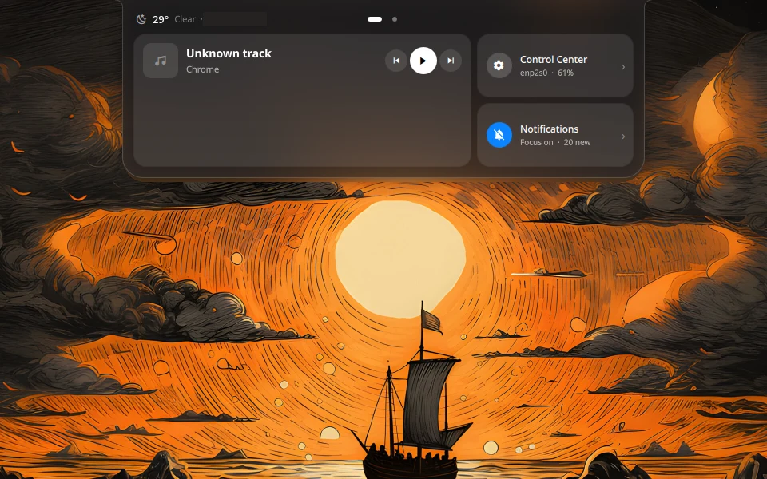
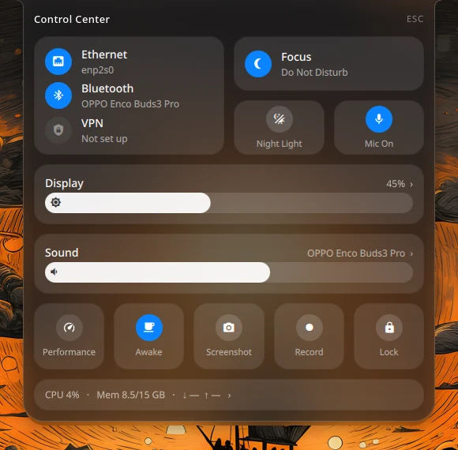
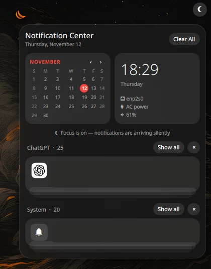

# Dynamic Island for Omarchy

A customized version of [Island Flight](https://github.com/Himanshu-MlSHRA/omarchy-dynamic-island) for [Omarchy](https://omarchy.org), with a Control Center, grouped notifications, and keyboard navigation.

Turns Omarchy's top bar into a phone-style **Dynamic Island**: a small pill with the time that opens into pages
for music, Wi-Fi, Bluetooth, sound, battery, Claude Code usage, system stats and quick toggles. Notifications,
volume and brightness appear inside it, and apps fly out of it when they open.



| Control Center | Notification Center |
| --- | --- |
|  |  |

Upstream walkthrough video and dotfiles: [omarchy-dotfiles](https://github.com/Himanshu-MlSHRA/omarchy-dotfiles)

## Install

```sh
omarchy plugin add https://github.com/Dev-Xrab/DynamicIsland.git
omarchy bar use io.github.himanshu-mlshra.dynamic-island
```

Then click the island at the top of the screen.

**Volume and brightness inside the island** (this also replaces the stock OSD, and restarts the shell once):

```sh
bash ~/.config/omarchy/plugins/io.github.himanshu-mlshra.dynamic-island/osd/enable.sh
```

The upstream [omarchy-dotfiles](https://github.com/Himanshu-MlSHRA/omarchy-dotfiles) include companion plugins for routing notification banners and menus through the island.

**Turn off the flying windows:** put `{ "windowFlight": false }` in `~/.config/omarchy/island.json`.

## Control Center and Notification Center

- **Island** (click the notch, `SUPER + B`): Now Playing, plus doors to Control Center and Notifications. `Tab` flips to
  the stats page.
- **Control Center** (the *Control Center* door, `SUPER + ALT + C`): the island grows into Wi-Fi/Ethernet, Bluetooth,
  VPN (NetworkManager), Focus, Night Light, Microphone, Power Mode (power-profiles-daemon), Display and Sound sliders,
  live CPU / memory / network / battery, and Screenshot · Record · Lock · Stay Awake. Click a disc or tile to toggle,
  the text or `›` for its detail pane (Back returns to Control Center).
- **Notification Center** (the bell at the top right, `SUPER + N`): slides in from the right with the date, Clear All,
  a calendar and a Today widget, and notifications grouped by app (`Show all` expands a group, hover a notification
  for `×` and `⌄`, click it to open its app). It reads the existing notification daemon; nothing new runs.

Only one panel is open at a time; `Escape` or a click outside closes it, and opening the launcher closes them all.
The keys need `island-keys.lua` loaded at the end of `~/.config/hypr/hyprland.lua`:

```lua
local island_keys = os.getenv("HOME") .. "/.config/omarchy/plugins/io.github.himanshu-mlshra.dynamic-island/island-keys.lua"
if io.open(island_keys, "r") then dofile(island_keys) end
```

Change a shortcut by setting `island_keys = { notification_center = "SUPER + ALT + N" }` before that line.

## Settings (`~/.config/omarchy/island.json`)

| Key | Default | |
|---|---|---|
| `autoCollapse` | `8` | seconds the open island stays up with the pointer away; `0` keeps it open until dismissed |
| `windowFlight` | `true` | windows fly out of the island |
| `glass` | `false` | glass look for the open island |
| `ncWidgets` | `true` | calendar and Today widgets in Notification Center |
| `reducedMotion` | `false` | near-instant transitions instead of springs and slides |

## Remove

```sh
omarchy bar reset
omarchy plugin remove io.github.himanshu-mlshra.dynamic-island-osd   # only if you enabled it above
omarchy plugin remove io.github.himanshu-mlshra.dynamic-island
```

If you added the `island-keys.lua` loader, remove it from `~/.config/hypr/hyprland.lua`.

## Requirements

- Omarchy 4 (the Quickshell shell). Made on Omarchy 4.0 with Hyprland 0.56.
- Nothing extra to install: it uses NetworkManager, bluez, brightnessctl, jq and ImageMagick, which all come with Omarchy.
- Optional: the [Maple Mono NF](https://github.com/subframe7536/maple-font) font (`omarchy pkg aur add maplemono-nf`) for the clock. Without it your monospace font is used.

## Credits

Based on Island Flight by Himanshu Mishra, which is built on Omarchy's own bar plugin (MIT). `PDotText.qml` and `PFlipText.qml` are from
[Panacea](https://github.com/EnsixD/Panacea) by EnsixD (MIT). Look inspired by Panacea and
[Atoll](https://github.com/Ebullioscopic/Atoll).

MIT licensed.
